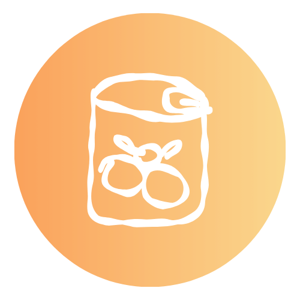
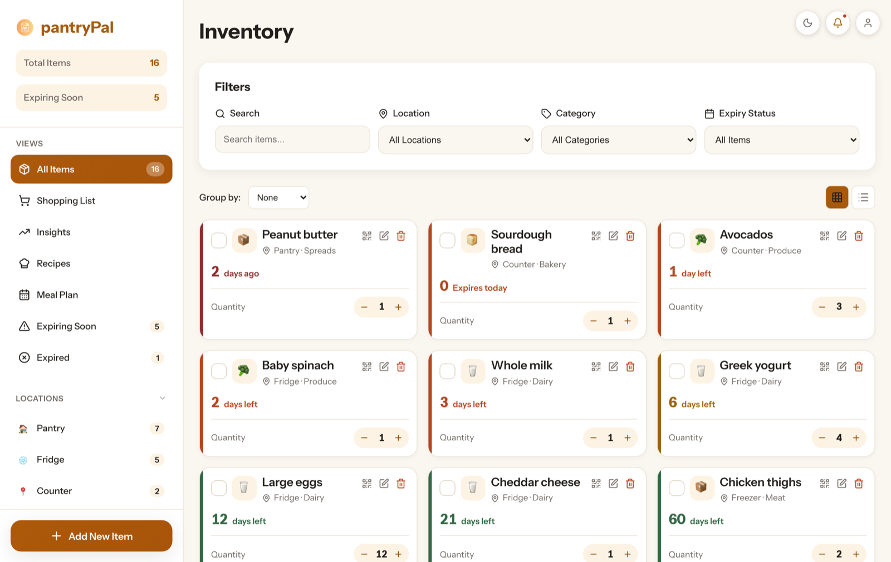
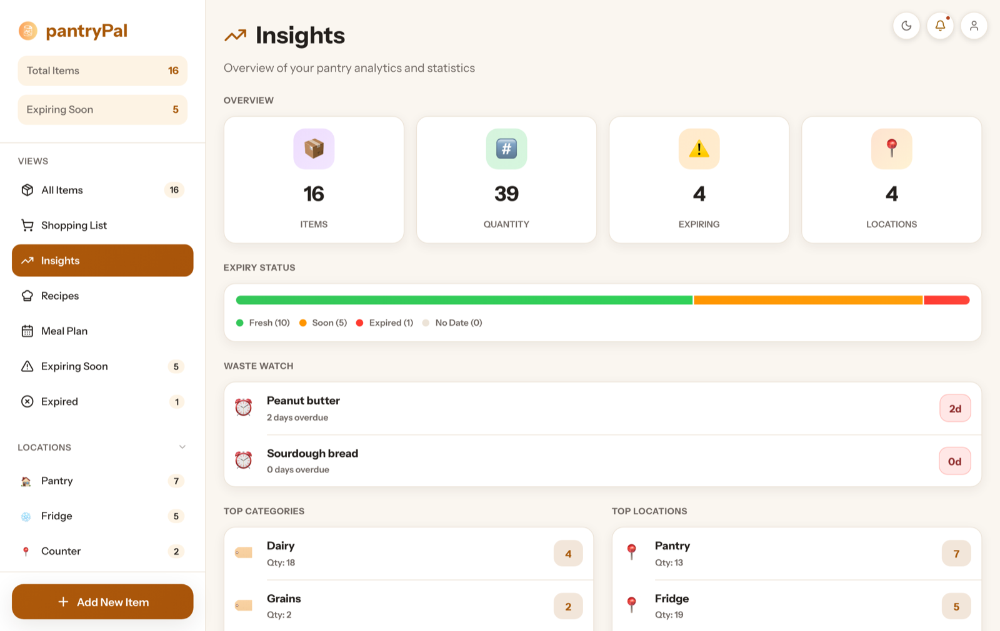
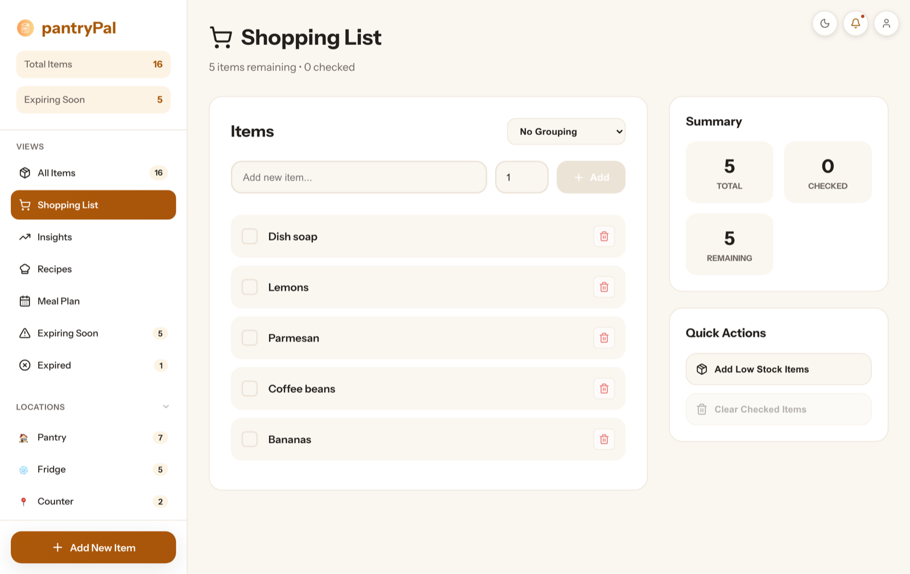
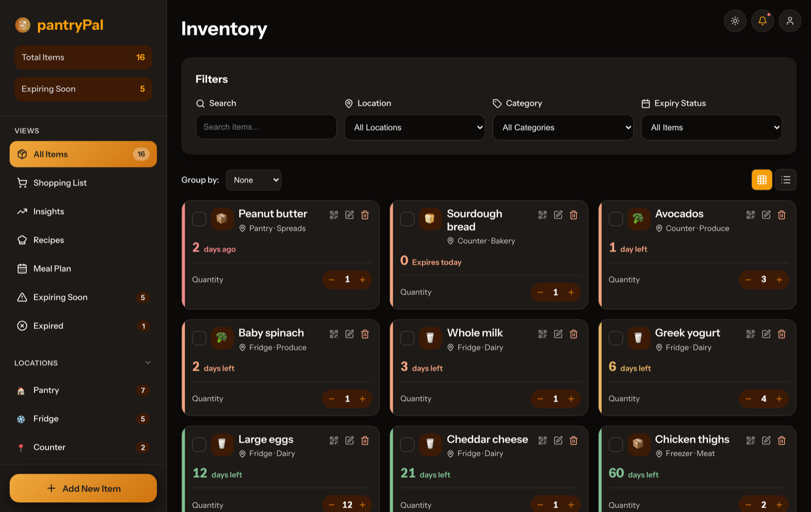

<div align="center">
  
  <h1>pantryPal</h1>
  <p><strong>Know what's in your kitchen. Use it before it goes off.</strong></p>

  <p>
    <a href="#quick-start">Quick start</a> ·
    <a href="https://pantrydemo.palstack.io">Live demo</a> ·
    <a href="https://palstack.io/pantrypal/docs">Documentation</a> ·
    <a href="https://discord.gg/mcgcp7RdYs">Discord</a>
  </p>

  <p>
    <a href="LICENSE"></a>
    <a href="https://github.com/orgs/palStack-io/packages?repo_name=pantrypal-core"></a>
    <a href="docs/HOME_ASSISTANT.md"></a>
  </p>
</div>

pantryPal is a self-hosted pantry tracker for a household. Scan or type in what you buy, see what is about to expire,
keep one shared shopping list, and find recipes that use what you already have. It runs on your own server with
Docker; nothing is sent to us.

This repository is **pantryPal Core**: open source, complete, and free to self-host.

> [!NOTE]
> pantryPal is under active development. Configuration and APIs can change between releases. Back up before
> upgrading, and pin an image tag (for example `pantrypal-api-gateway:api-gateway-<commit>`) instead of `:latest` if you need stability.

<p align="center">
  
  
</p>

## Features

- **Inventory by location.** Fridge, freezer, pantry or your own locations, with categories, quantities and notes.
- **Barcode lookup.** Scan with a phone camera or type a code; product details come from Open Food Facts (with a
  UPCitemDB fallback) and are cached for 30 days. Items without a barcode can be added by hand.
- **Expiry tracking.** Four levels (upcoming, warning, critical, expired), an Expiring Soon view and a waste watch.
- **Shared shopping list.** One list for the household; checked items move into the inventory.
- **Recipes.** Import from your own [Mealie](https://mealie.io) or [Tandoor](https://tandoor.dev) server, see which
  recipes you can make now, and which use items about to expire.
- **Meal plan.** A household meal calendar built from your recipes, with an `.ics` download for your calendar app.
- **QR labels and CSV export** for jars, leftovers and backups of your data.
- **Home Assistant.** Read expiring items and manage the shopping list over the REST API with an API key.
  See [docs/HOME_ASSISTANT.md](docs/HOME_ASSISTANT.md).
- **Sign-in your way.** Password accounts, Google and Apple sign-in, or any OIDC provider (Authentik, Keycloak, Authelia,
  Okta, Microsoft Entra ID).
- **Installable web app** with dark mode and offline support: changes made offline sync when you reconnect.

<p align="center">
  
  
</p>

## Quick start

You need Docker with the Compose plugin, 1 GB of RAM and 2 GB of disk. The compose file pulls prebuilt images
(`linux/amd64`; on ARM, build from source with `docker-compose.dev.yml`).

```bash
mkdir pantrypal && cd pantrypal
curl -fsSL -o docker-compose.yml https://raw.githubusercontent.com/palStack-io/pantrypal-core/main/docker-compose.yml
curl -fsSL -o .env https://raw.githubusercontent.com/palStack-io/pantrypal-core/main/.env.example

# Generate your own secrets (pantryPal ships with none and refuses to start without them)
for key in DB_PASSWORD SECRET_KEY INTERNAL_SERVICE_TOKEN ENCRYPTION_SALT; do
  sed -i.bak "s|^$key=.*|$key=$(openssl rand -hex 32)|" .env
done
sed -i.bak "s|^ADMIN_DEFAULT_PASSWORD=.*|ADMIN_DEFAULT_PASSWORD=$(openssl rand -base64 18)|" .env && rm .env.bak

docker compose up -d
grep ^ADMIN_DEFAULT_PASSWORD .env   # your admin password
```

Open **http://localhost:8888** and sign in as `admin` with the password printed by the last command. Then:

1. Change the admin password in **Settings**.
2. Add household members under **Admin → Users** (open registration is off by default).
3. Set `APP_URL` and the `SMTP_*` settings in `.env` if you want password-reset and invitation emails.

To serve on another port, set `HTTP_PORT` in `.env`. Put pantryPal behind a reverse proxy with HTTPS (Caddy,
nginx, Traefik) before exposing it outside your network.

**Upgrade:** `docker compose pull && docker compose up -d`.
**Back up:** set `DB_BACKUP_ENABLED=true` for scheduled database and image backups;
see [docs/BACKUP_AND_RESTORE.md](docs/BACKUP_AND_RESTORE.md).

Other ways to run it: `docker-compose.dev.yml` builds every service from this checkout, and
`docker-compose-portainer.yml` is a single file for the Portainer stack editor.

## Core and hosted

pantryPal Core is the whole product for one household on your own server. palStack also runs a hosted edition,
which is what the [live demo](https://pantrydemo.palstack.io) shows.

| | Core (this repository) | Hosted |
|---|---|---|
| Inventory, barcode lookup, expiry tracking, locations, categories, QR labels | Yes | Yes |
| Shared shopping list, recipes from Mealie or Tandoor, meal plan | Yes | Yes |
| Home Assistant and API keys | Yes | Yes |
| Password, Google and Apple sign-in | Yes | Yes |
| Any OIDC provider (Authentik, Keycloak, Authelia, Entra ID) | Yes | No |
| Households | One shared pantry per server | Several pantries, with paid plans |
| Receipt scanning, AI recipe suggestions, nutrition | No | Paid plans |
| Backups | Built-in backup container you run | Managed |
| Where your data lives | Your server | palStack's servers |

The pantryPal phone app (in testing) can connect to either; on a Core server, hosted-only features are hidden.

## Architecture

```
nginx                    reverse proxy, serves the web app
├── api-gateway          FastAPI: auth, sessions, OIDC, recipes, meal plan, images, email
├── inventory-service    items, locations, shopping list
├── lookup-service       barcode to product, cached
├── web-ui               React + TypeScript, installable web app
├── postgres             PostgreSQL 15
└── backup               scheduled database and image backups (opt-in)
```

## Documentation

| Guide | What's in it |
|---|---|
| [Configuration](docs/CONFIGURATION.md) | Every `.env` setting, sign-in modes, the shared household, recipe integrations |
| [Authentication](docs/AUTHENTICATION.md) | Sessions, API keys, Google and OIDC setup |
| [Home Assistant](docs/HOME_ASSISTANT.md) | Sensors, shopping-list automations, API keys |
| [Deployment](docs/DEPLOYMENT.md) | Reverse proxies, HTTPS, Portainer |
| [Backup and restore](docs/BACKUP_AND_RESTORE.md) | Scheduled backups and how to restore them |
| [Email link troubleshooting](docs/TROUBLESHOOTING_EMAIL_LINKS.md) | When reset links point at the wrong address |
| [Changelog](CHANGELOG.md) | What changed, release by release |

Full documentation: **[palstack.io/pantrypal/docs](https://palstack.io/pantrypal/docs)**.

## Contributing

We have paused code contributions while we work out how to review AI-assisted changes well. Bug reports, ideas and
questions are very welcome: open an [issue](https://github.com/palStack-io/pantrypal-core/issues) or join us on
[Discord](https://discord.gg/mcgcp7RdYs).

Found a security problem? Please report it privately; see [SECURITY.md](https://github.com/palStack-io/.github/blob/main/SECURITY.md).

## License

pantryPal Core is licensed under the [GNU Affero General Public License v3.0](LICENSE). You can use, change and
self-host it freely. If you run a modified version as a network service, you must publish your changes under the
same licence.

pantryPal is built for personal and household use. To run it commercially, or as a service without the AGPL's
obligations, contact **support@palstack.io** about a commercial licence.

---

<div align="center">
  <sub>Part of <a href="https://palstack.io">palStack.io</a>: everyday tools for food, money, home and friends.</sub>
</div>
